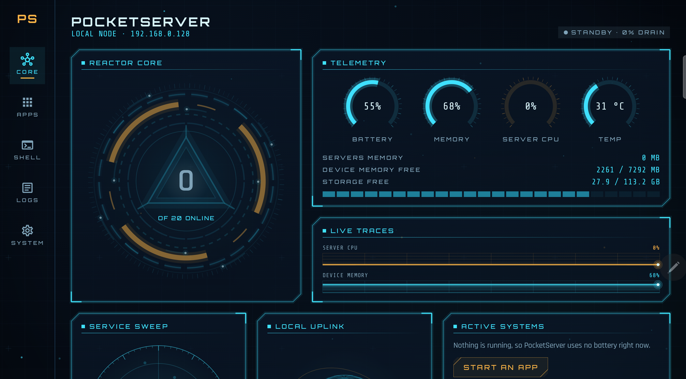
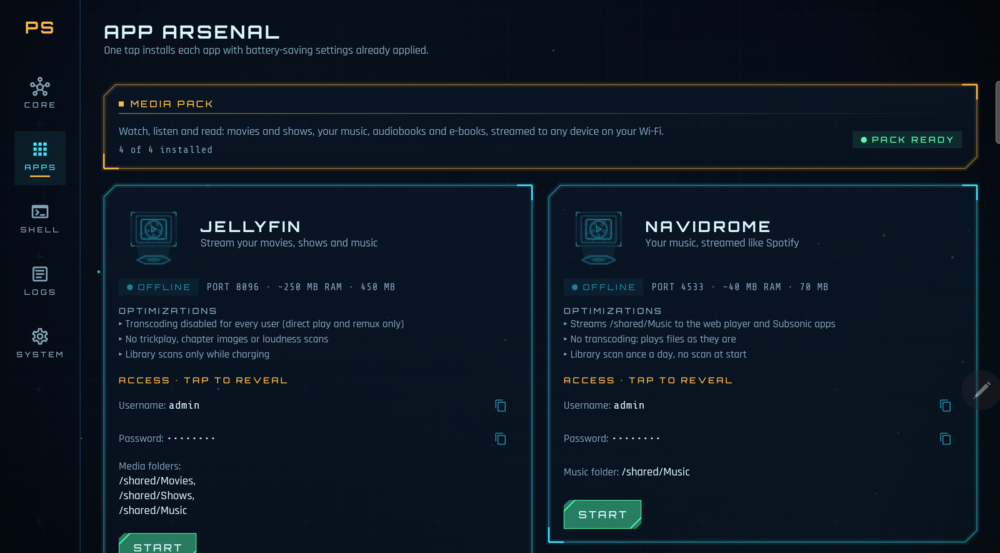
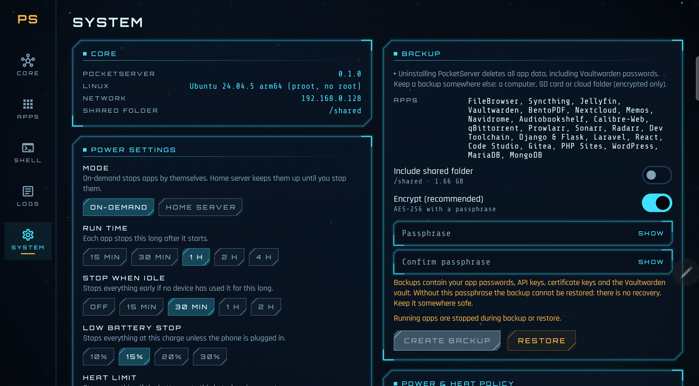
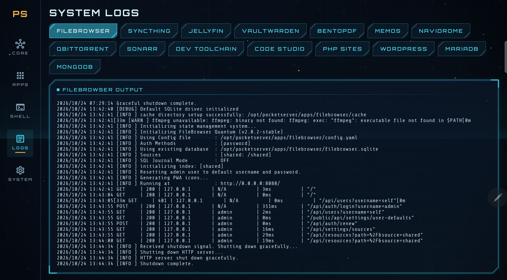

# PocketServer

**Turn an Android phone or tablet into a private home server. No root, no cloud, no accounts.**

PocketServer runs a full Ubuntu 24.04 (arm64) inside the app using [proot](https://github.com/termux/proot) and
gives you one-tap installs of popular self-hosted apps: media streaming, file sync, a password manager, dev tools
and more. Everything stays on your device and your local Wi-Fi.



## Why

That old phone or tablet in a drawer has more CPU and storage than many home servers. PocketServer turns it into
one, without rooting it, without sending your data to anyone and without cooking the battery.

## Features

- **One-tap apps, grouped into packs**, each installed with battery-saving settings already applied.
- **Real Linux, no root:** Ubuntu 24.04 in proot, with a built-in terminal (root shell inside the sandbox).
- **Battery and heat first:**
  - Nothing runs until you press Start. With every app stopped, the app does no background work.
  - Servers are pinned to the efficiency cores at low priority.
  - No transcoding, no telemetry, no self-updaters inside apps. Heavy jobs such as library scans run only while
    charging.
  - A thermal guard watches battery temperature and Android's thermal status. When it gets hot, it pauses heavy
    work and then stops servers.
  - Two modes: on-demand (apps stop on their own after a set run time or when idle) or home server (apps stay up,
    optionally only while charging).
- **Local network only:**
  - No tunnels, relays, UPnP or remote access.
  - Databases are reachable only from this device unless you flip their Wi-Fi access switch, which always uses a
    password.
  - HTTPS apps use a local certificate authority that is restricted to local names and private IPs.
- **Unique secrets per install:** every password, token and key is generated on your device when you install.
- **Encrypted backups:** backup and restore of all app data (AES-256-GCM with your passphrase).
- **SD card support** for media folders.
- **Clean uninstall:** all data lives in the app's private storage, so uninstalling leaves nothing behind.
- **A sci-fi HUD interface** that works on phones and tablets, with a reduced-motion mode.

## Apps

| Pack | Apps |
|---|---|
| **Media** | Jellyfin, Navidrome, Audiobookshelf, Calibre-Web |
| **Files & Cloud** | FileBrowser Quantum, Syncthing, Nextcloud |
| **Downloads** | qBittorrent, Prowlarr, Sonarr, Radarr |
| **Productivity** | Vaultwarden, BentoPDF, Memos |
| **Web Dev** | Dev Toolchain, Django & Flask, Laravel, React, Code Studio (code-server), PHP Sites, WordPress, MariaDB, MongoDB 7, Gitea |

## Screenshots

| App packs | System and backup |
|---|---|
|  |  |



## Requirements

- Android 10+ on a 64-bit ARM device (arm64-v8a)
- About 1 GB free for Ubuntu, plus whatever the apps and your media need
- Wi-Fi (other devices connect over your local network)

## Install

Download the APK from the [Releases](https://github.com/pntapps/PocketServer/releases) page and install it.
PocketServer is not on Google Play.

On first launch the app downloads and verifies Ubuntu Base, then shows the app packs. Tap an app to install it,
press **Start**, and open the address shown on its card from any device on your Wi-Fi.

## Build from source

You need Android Studio (for the JDK and Android SDK).

```sh
./gradlew :app:assembleDebug        # debug APK
./gradlew :app:testDebugUnitTest    # unit tests
```

Release signing reads `keystore.properties`, which is git-ignored and never committed.

## How it works

- `linux/`: proot launcher, Ubuntu rootfs installer, canonical paths.
- `server/`: AppManager (install queue, start/stop, readiness checks), foreground service, power policy and
  thermal guard.
- `catalog/` and `app/src/main/assets/catalog/<app>/`: each app is a shell recipe (`install.sh`, `start.sh`)
  that runs inside Ubuntu.
- `ui/`: Jetpack Compose HUD screens (Dashboard, Apps, Shell, Logs, System).

## License

PocketServer is free software under the [GNU GPL v3](LICENSE).

It bundles [proot](https://github.com/termux/proot) (GPLv2) and talloc (LGPLv3) from the Termux project as
prebuilt arm64 libraries. Their source code is available from the linked upstream repositories. Each self-hosted
app is downloaded from its own upstream at install time and keeps its own license.

"PocketServer" and the PocketServer icon identify this project. Please use a different name and icon if you
distribute a modified version.
